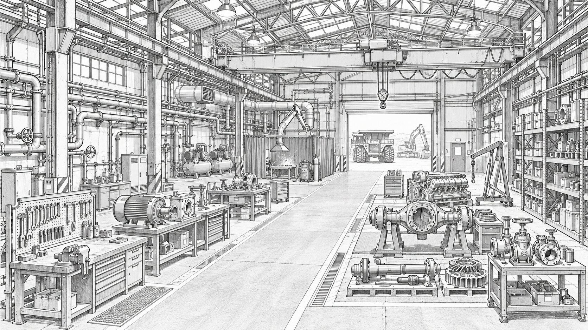
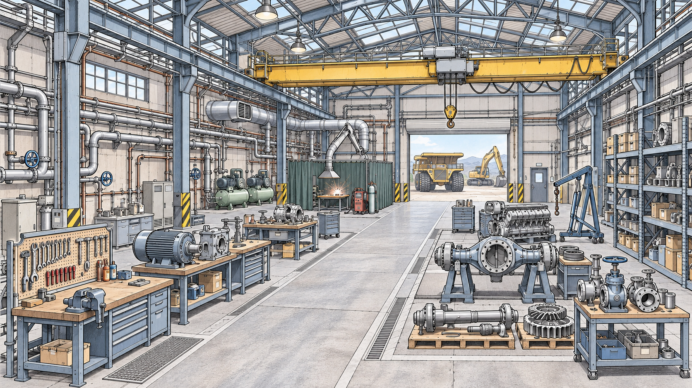
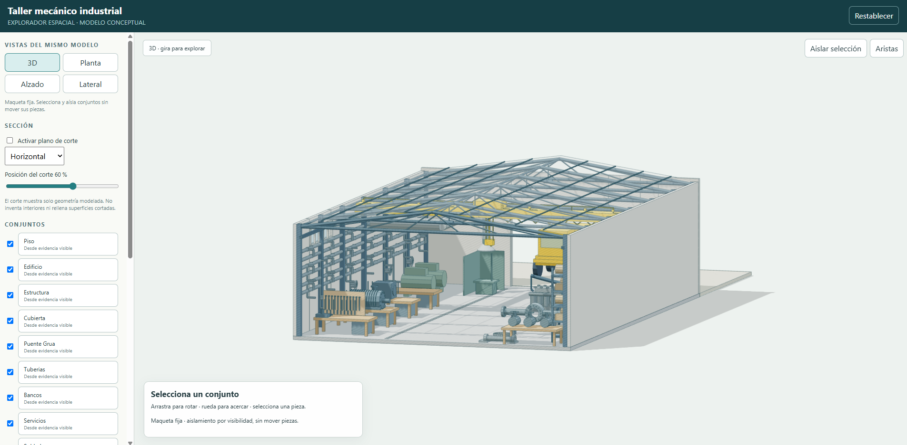

# Scene Layout Forge

Skill para crear ilustraciones técnicas detalladas en grafito y tinta, editarlas fielmente a color y, cuando se solicite, reconstruirlas como maquetas 3D interactivas.

**Revisión:** 2026-11-18.37 · **Invocación:** `$scene-layout-forge`

La skill puede representar edificios, entornos urbanos, instalaciones, vehículos, planos e interiores mecánicos. Desarrolla un plan espacial, conserva las conexiones y los apoyos visibles, y exige revisar el resultado visual. Los archivos de trabajo y las revisiones se conservan en el historial del proyecto.

## Ejemplo: taller mecánico industrial

Este ejemplo muestra una ilustración de un taller con estructura, maquinaria, herramientas y tuberías, seguida de su edición a color.

### Ilustración en grafito



### Edición coloreada



### Explorador 3D experimental



La reconstrucción 3D está en desarrollo. Esta maqueta conceptual permite girar, acercar, seleccionar conjuntos y usar vistas de planta y cortes. Sus máquinas y tuberías están simplificadas frente a la ilustración y las partes ocultas se infieren; no es un modelo constructivo.

[Descargar el explorador HTML experimental](https://github.com/DavidVilem/scene-layout-forge/raw/refs/heads/gh-pages/explorador.html) y abrirlo en un navegador compatible con WebGL. GitHub muestra el código de los archivos HTML en su vista normal; para ejecutarlo desde un enlace web es necesario configurar GitHub Pages.

Las imágenes y el HTML se conservan en la rama [`gh-pages`](https://github.com/DavidVilem/scene-layout-forge/tree/gh-pages), separadas del paquete de la skill.

## Resultados

Por defecto se generan, en este orden:

1. `ilustrada.png`: ilustración en grafito gris y tinta fina.
2. `coloreada.png`: edición a color de la ilustración revisada, conservando su composición.

Si se solicita explícitamente, se añade `explorador.html`, una maqueta fija con órbita, zoom, selección, aislamiento por visibilidad, cortes, vistas de planta y elevación y exportación esquemática SVG. El visor incluye Three.js y se abre sin conexión en un navegador con WebGL.

También puede solicitarse una animación ambiental `animada.mp4`. Consulta los [detalles de animación](references/subtle-animation.md) y sus requisitos opcionales.

La reconstrucción 3D es un trabajo de modelado asistido, no un servicio automático que recupere toda la geometría de una imagen. Las partes ocultas y las dimensiones se infieren; el modelo no sustituye planos constructivos ni una verificación de ingeniería. Consulta el [flujo de reconstrucción](references/reconstruction-kernel.md), la [revisión de fidelidad](references/fidelity-acceptance.md) y el [ejemplo 3D](examples/worked-cases/explorer-3d.md).

## Instalación

Copia la carpeta completa del repositorio como `scene-layout-forge` en el directorio de skills de tu agente. Para instalarla en un proyecto de Codex, utiliza:

```text
.agents/skills/scene-layout-forge
```

Abre una conversación nueva en el proyecto e invoca `$scene-layout-forge`. Para las herramientas de geometría se necesita Python 3.11 o posterior y los paquetes indicados en [requirements.txt](requirements.txt):

```sh
python -m pip install -r requirements.txt
```

La ilustración y su edición a color necesitan una herramienta de generación y edición de imágenes disponible en el entorno. Las utilidades locales de geometría no necesitan una clave API; el renderizador local genera guías y no sustituye el acabado artístico.

## Ejemplo de solicitud

> Usa `$scene-layout-forge` para ilustrar una estación de investigación orbital con módulos habitables, cerchas y paneles solares. Elige una vista técnica clara, conserva las conexiones y guarda `ilustrada.png`, `coloreada.png` y una maqueta 3D interactiva `explorador.html` en una carpeta nueva. Conserva el historial.

## Organización del repositorio

- [SKILL.md](SKILL.md): instrucciones principales para el agente.
- [kit](kit/__init__.py): interfaz Python de las herramientas de geometría.
- [examples](examples/README.md): escenas, recetas, solicitudes y ejemplos de uso.
- [references](references/art-direction.md): dirección artística, geometría, renderizado y revisión.
- [evals](evals/README.md): casos de evaluación y criterios de revisión.
- [scripts](scripts/run_example.py): construcción de guías, validación y auditoría.
- [tests](tests/test_portability.py): pruebas de portabilidad y distribución.
- [.github/workflows/ci.yml](.github/workflows/ci.yml): comprobaciones automatizadas.

Las instrucciones principales de la skill y otros documentos técnicos pueden estar en inglés.

## Comprobaciones locales

Desde la raíz del repositorio, con las dependencias instaladas:

```sh
python -B examples/twin-vessels/build.py --out-dir ../layout-review/twin-vessels
python -B scripts/check_examples.py
python -B scripts/check_package.py
python -B -m unittest discover -s scripts -p "test_*.py"
python -B -m unittest discover -s tests -p "test_*.py"
```

El primer comando crea una **guía calculada**, aunque su PNG se llame `ilustrada.png`; no genera la ilustración artística final. Las pruebas numéricas no certifican la calidad visual ni la seguridad estructural. La revisión debe examinar las imágenes y, si se solicita 3D, el explorador real en un navegador. Consulta [verificación](references/verify.md) y [evaluaciones](evals/README.md).

## Distribución y licencia

Conserva el código, las instrucciones, los ejemplos procedurales y los avisos de terceros. Los resultados de usuarios, credenciales, historiales y cachés se guardan fuera de la skill.

El código del proyecto se distribuye bajo la [licencia MIT](LICENSE). Three.js conserva su [aviso de licencia MIT y derechos de autor](assets/explorer/THREE-LICENSE.txt).
